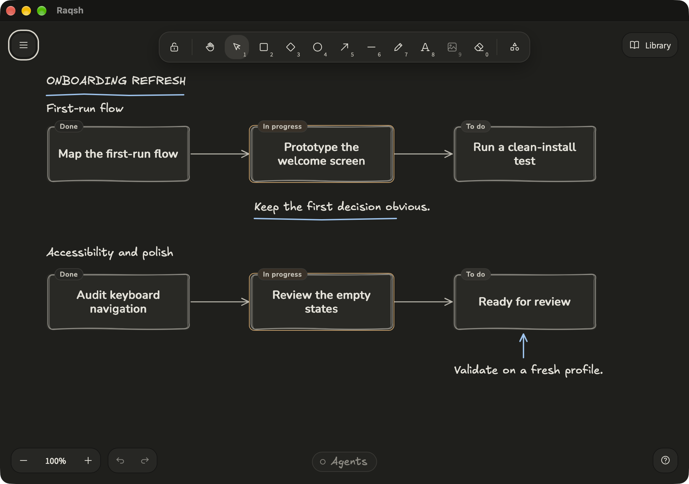
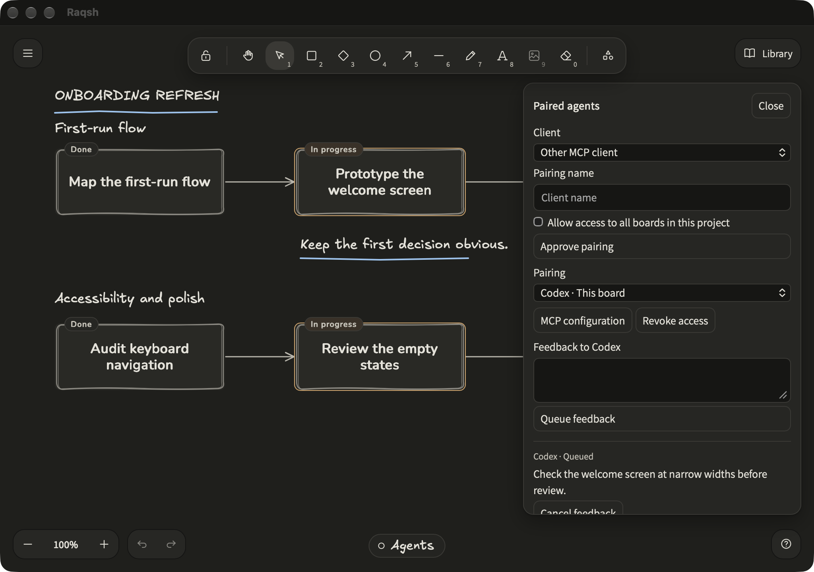

<p align="center"></p>
<h1 align="center">Raqsh</h1>
<p align="center">A local-first whiteboard for planning with coding agents.</p>
<p align="center">
  <a href="https://github.com/MohamedElashri/raqsh/releases/latest"></a>
  <a href="https://github.com/MohamedElashri/raqsh/actions/workflows/ci.yml"></a>
</p>

<table>
  <tr>
    <td width="50%"></td>
    <td width="50%"></td>
  </tr>
</table>

## Install

Download [the latest release](https://github.com/MohamedElashri/raqsh/releases/latest) for macOS (Apple silicon or Intel), Ubuntu x86-64 (`.deb`), or Fedora x86-64 (`.rpm`). On macOS, unzip the download and move Raqsh to Applications.

```sh
curl -fsSL https://github.com/MohamedElashri/raqsh/releases/latest/download/install.sh | sh
```

> **First launch on macOS.** Raqsh is ad hoc signed and has no Apple notarization ticket. Gatekeeper may block the downloaded app. If that happens, verify the ZIP against `SHA256SUMS` from the same GitHub release, then remove the quarantine attribute from your installed copy of Raqsh only. [Apple’s explanation of Gatekeeper](https://support.apple.com/en-us/102445)
>
> In Terminal, type `xattr -dr com.apple.quarantine` followed by a space. Drag your installed copy of Raqsh from Finder into Terminal to add its path, then press Return. The shell installer puts Raqsh in `~/Applications`.

## Get started

Open a project folder, create a board, and press **N** on the canvas to add a card. To connect an agent, open **Agents**, choose Codex or Claude Code, and approve the pairing. Raqsh registers its bundled MCP helper. Open a new session in your client to use it.

Check for updates under **Settings → About**. Checking, downloading, installing, and restarting are each started from the app. Boards are stored on your device.

## Development

Install the dependencies and start the desktop app in development mode.

```sh
pnpm install --frozen-lockfile
pnpm desktop:dev
```

Run `pnpm desktop:build` to build the desktop app and MCP helper. [Prerequisites, tests, and packaging](docs/development.md)

## Contributing

Bug reports, ideas, and fixes are welcome. [Open an issue](https://github.com/MohamedElashri/raqsh/issues/new) or [submit a pull request](https://github.com/MohamedElashri/raqsh/compare).

## License

Raqsh is free for personal and noncommercial community use under the [PolyForm Noncommercial License 1.0.0](LICENSE), with a separate license required for commercial use outside those terms.
